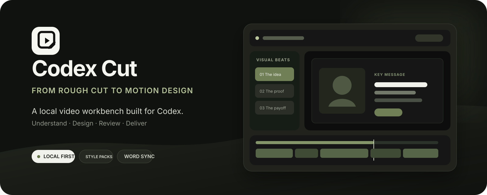
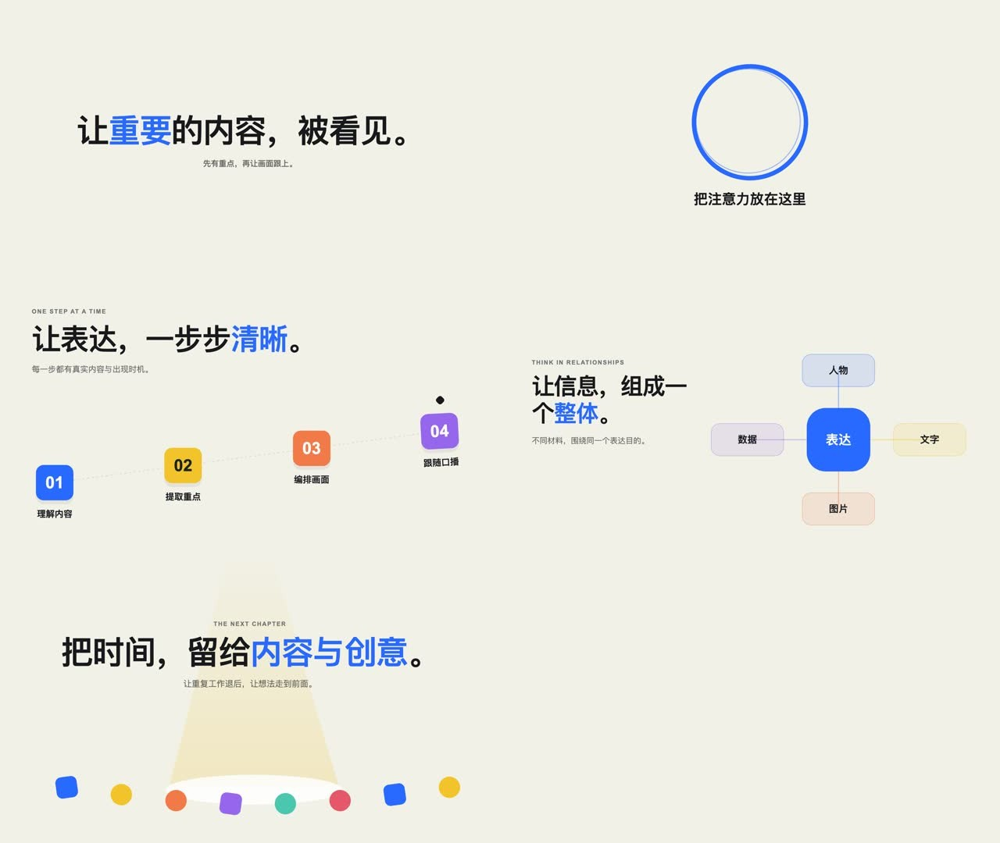
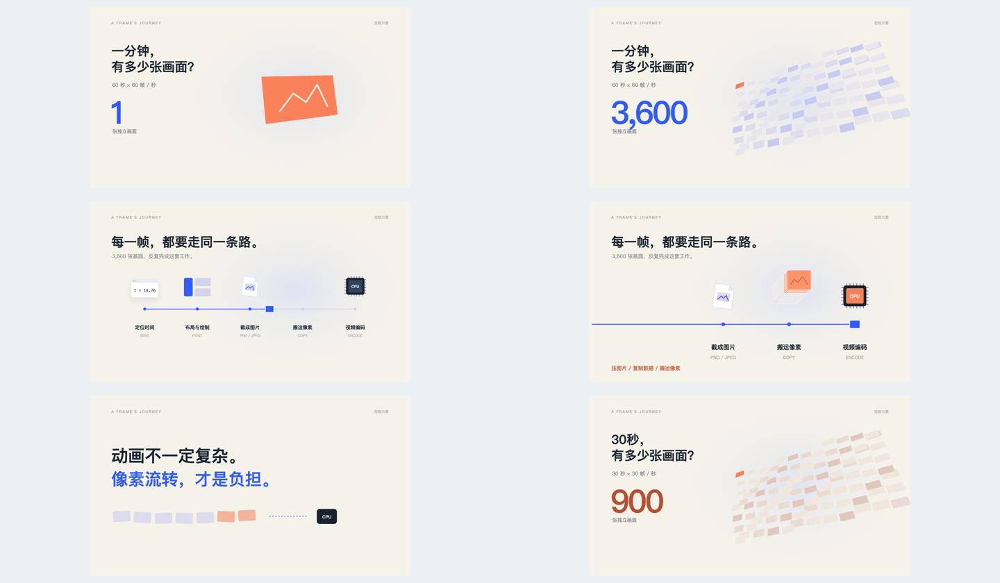
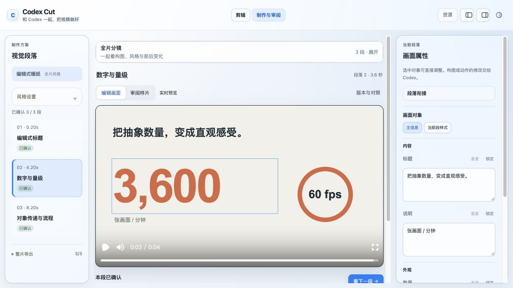
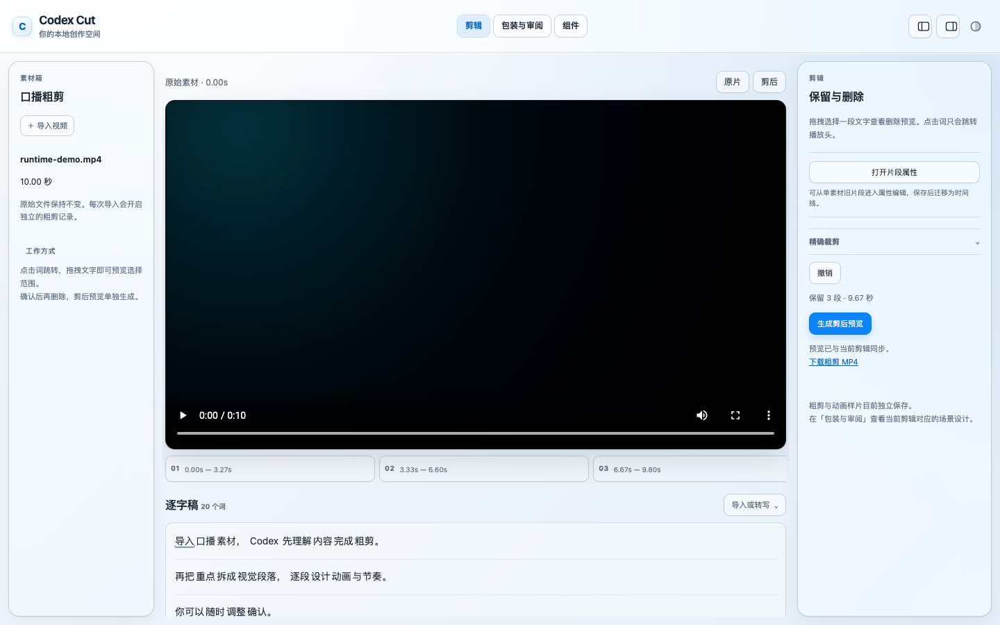
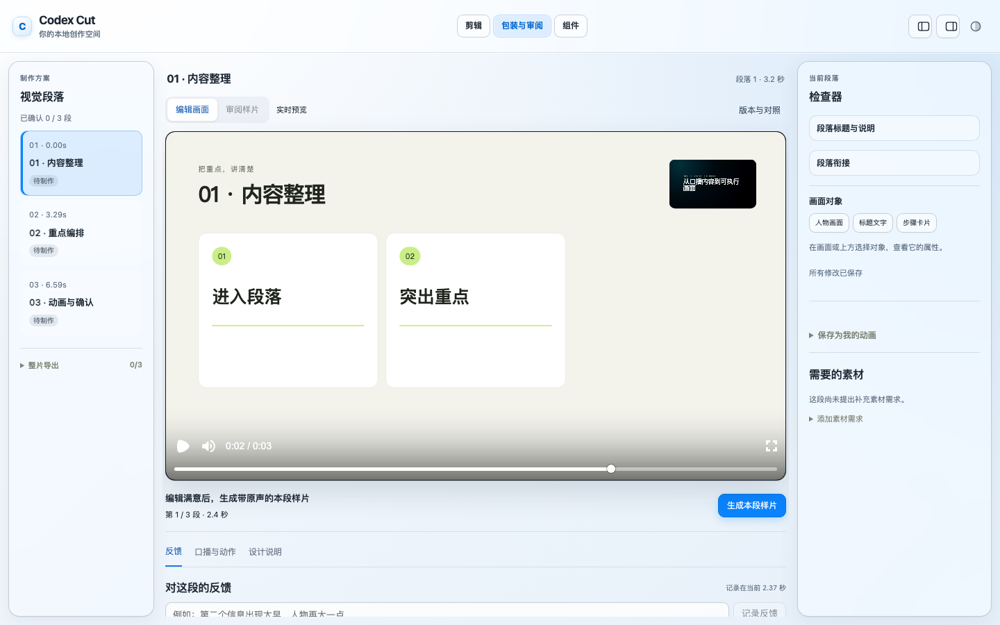
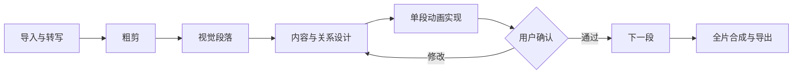
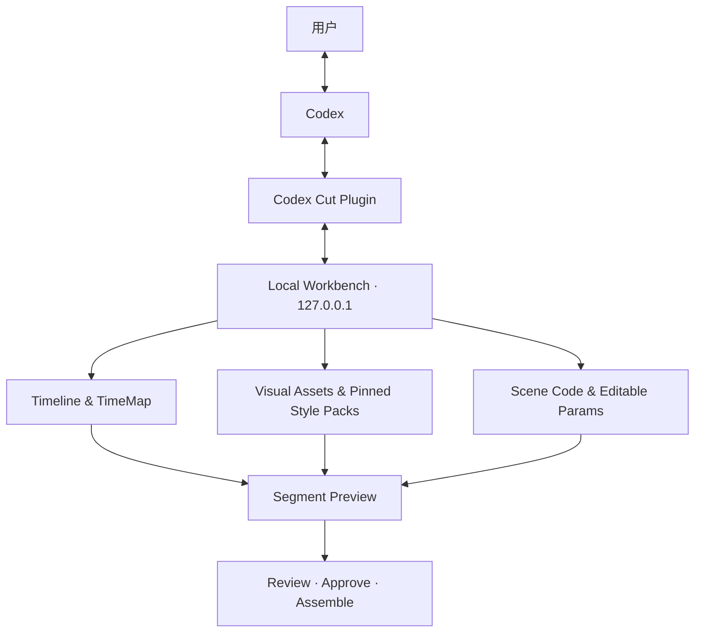

<p align="center">
  
</p>

<p align="center">
  <strong>让一个 Agent 从口播粗剪走到动画包装，再由人把控最终审美。</strong>
</p>

<p align="center">
  <a href="#真实运行演示">运行演示</a> ·
  <a href="#操作界面">操作界面</a> ·
  <a href="#核心能力">核心能力</a> ·
  <a href="#六步制作方法">制作流程</a> ·
  <a href="#快速开始">快速开始</a> ·
  <a href="#codex-插件">Codex 插件</a> ·
  <a href="#工程边界">工程边界</a> ·
  <a href="#许可">许可</a>
</p>

---

## 真实运行演示

<p align="center">
  <a href="assets/readme/style-pack-demo.mp4"></a>
</p>

<p align="center">
  <strong>从可编辑资产到连续风格演示。</strong><br />
  <sub>五项原创几何示例的实际渲染；可替换文字、列表、颜色与语义出现点。</sub>
</p>

<p align="center">
  <a href="assets/readme/style-pack-demo.mp4">播放风格演示 MP4</a> ·
  <a href="examples/paper-style/README.md">查看原创示例与导入方法</a> ·
  <a href="docs/REFERENCE_LIBRARY.md">参考提炼与视觉资产库</a>
</p>

演示仅使用原创几何和通用内容，不含私人参考画面、人物、逐字稿或音乐。它是静音技术演示；资产入库选择与用户影片的原声审阅分别进行。新安装的视觉库为空，示例需明确导入。

**v0.2.3：工作台回到看、改和确认。** 只保留「剪辑」「制作与审阅」两个主工作区，资源是辅助入口；设计和检查交给 Codex，用户直接调参数、留意见和逐段确认。样片完成后打开结果，确认后进入下一段，最后一段可接续合成。「我的动画」接回统一资源入口，草稿和旧存档继续保留。详见[精简后的使用流程](docs/SIMPLIFIED_WORKFLOW.md)。

**v0.2.2：全片共同风格与分镜对照。** 新段落自动继承已绑定的字体、色板、线条和运动设置；包装页可展开真实关键帧总览，放大、定位和查看 Codex 检查记录。各段按内容设计构图，保留用户调整与锁。详见[全片风格与分镜](docs/FILM_DIRECTION.md)。

**v0.2.1：按内容直接原创。** Codex 可以直接编写连续场景，以 SVG、Canvas 或已声明的 Three.js 能力实现对象变化和镜头编排；必要的参数在工作台编辑，有复用价值时再入库。风格包可指导不同原创构图，并显示逐段样式映射、保留设置和待适配范围。查看[原创连续场景示例与重建命令](examples/continuous-scene/README.md)。

[](assets/readme/continuous-scene-demo.mp4)

[播放 18 秒原创连续场景](assets/readme/continuous-scene-demo.mp4)。静音技术演示；右下角为更换时长、帧率与强调色后的实际输出。

| 输入 | Codex 负责 | 工作台负责 | 用户得到 |
|---|---|---|---|
| 原视频、逐字稿、素材与修改意见 | 粗剪判断、重点提取、画面设计、动画实现 | 时间映射、素材绑定、预览、参数、版本与渲染 | 可播放、可修改、可逐段确认的成片工程 |

## 操作界面

### 制作与审阅 · v0.2.3



日常操作集中在播放、调参、反馈与逐段确认；设计说明和技术控制按需展开。截图来自原创几何测试工程，确认状态用于交互验证，不代表用户影片已被确认。

以下两张截图记录 v0.1.0 基线的剪辑与审阅布局；当前 v0.2.3 候选版的使用流程与资源入口见下方说明。

### 逐字稿粗剪

<p align="center">
  
</p>

按口播文字选择、删除和校正内容，同时保留完整视频预览、剪辑段落与可撤销操作。

### 逐段制作与审阅

<p align="center">
  
</p>

每个视觉段落单独设计、播放和生成带原声样片。左侧管理段落，中央检查真实动画，右侧调整对象与素材需求。

### 全片分镜对照 · v0.2.2


侧栏可收起，给真实画面对照留出空间。每段切换前中后三张关键帧，点击放大或直接定位编辑；Codex 的画面观察与用户确认独立保存。截图使用原创几何与通用文字的独立技术样片，不包含用户素材。

### 视觉资产库

右上角「资源」包含 **风格包 / 单项效果 / 我的动画 / 参考视频**：观看实际效果、编辑内容与参数、查看素材槽和语义事件，再添加到当前内容的目标段落。候选与可用版本分开管理；用户明确选择后才进入可用状态。

旧 194 项已移至 `modules/legacy/`，只解析历史项目已有引用，不用于新选型。复杂画面仍可由 Codex 原创实现。

## Codex Cut 是什么

Codex Cut 是一个 **Codex 驱动、本地运行的视频剪辑与动画包装工作台**。Codex 负责理解内容、提取重点、编排视觉层级和实现动画；工作台负责稳定的素材、时间、版本、预览、手动调节、逐段确认与最终合成。

它面向口播、访谈、教程和知识类视频。创作过程围绕真实文稿与口播节奏展开，让动画在说到对应内容时依次出现。

> 当前升级版本：`v0.2.3` 候选 · 本地优先 · 首轮 16:9 工作流 · 项目和媒体默认不进入 Git。用户资产选择、段落确认及正式合成仍待完成，详见[执行记录](docs/plans/2026-10-21-reference-distillation-style-packs.md#11-执行记录2026-10-21)。

## 核心能力

| | 能力 | 实际行为 |
|---|---|---|
| **01** | 文稿驱动粗剪 | 导入素材、转写、按词编辑口播，剪辑结果保持画面与声音同步 |
| **02** | 六步视觉设计 | 从视觉段落、信息对象和关系出发，再决定布局、包装与动画实现 |
| **03** | 逐词动画同步 | 动画绑定具体词句；剪辑变化后重新计算成片时间，失效引用明确提示 |
| **04** | 逐段制作与确认 | 每个视觉段落单独预览、渲染带原声样片、反馈和确认，再合成全片 |
| **05** | 可编辑场景 | 文案、字体、颜色、位置、素材和动画参数可调；结构性改动由 Codex 修改代码 |
| **06** | 参考提炼与风格包 | 从真实参考重建可编辑候选，换内容验证，固定资产版本；风格包共享样式、连续演示与局部覆盖 |
| **07** | 本地版本保护 | revision、哈希、原子保存、撤销、过期任务保护和已确认版本共同守住用户修改 |
| **08** | 素材提需 | 缺失素材挂在对应段落，保留理想设计，同时允许继续处理其他段落 |

## 六步制作方法

| 1 · 粗剪 | 2 · 视觉段落 | 3 · 视觉对象 |
|---|---|---|
| 删除废话、口误与无效停顿，确认内容地基 | 依据论述结构划分画面任务和节奏 | 为每段确定唯一主信息与辅助证据 |

| 4 · 信息布局 | 5 · 包装设计 | 6 · 动画实现 |
|---|---|---|
| 用构图表达并列、对比、流程、因果等关系 | 决定哪些对象需要被强调以及为什么 | 选择组件、改造组件或编写新场景，并绑定口播词句 |



## 工作方式



- **Codex** 做语义理解、创意判断、视觉编排和复杂动画开发。
- **工作台** 掌管稳定 ID、媒体真实性、时间映射、几何参数、revision、撤销和持久化。
- **用户** 查看真实画面和带原声样片，调节参数并决定是否确认。

## 快速开始

### 环境

- Node.js `>= 22.13.0`
- FFmpeg 与 ffprobe
- Whisper（需要本地转写时）
- 当前完整流程在 Apple Silicon macOS 上完成验证

### 启动

```bash
git clone https://github.com/zhangyuyao-zx/codex-cut.git
cd codex-cut
npm ci
npm start
```

打开 [http://127.0.0.1:4340](http://127.0.0.1:4340)。在 macOS 上也可以双击 **打开工作台.command**。

```bash
npm run status   # 查看服务状态
npm run stop     # 保存后停止服务
npm run dev      # 开发模式
```

正式渲染还需要匹配当前平台的浏览器与 Remotion 合成器。可使用以下环境变量指向本机运行时：

| 变量 | 用途 |
|---|---|
| `WORKBENCH_PROJECT_DIR` | 独立工程目录 |
| `WORKBENCH_PORT` | 服务端口，默认 `4340` |
| `WORKBENCH_FFMPEG` / `WORKBENCH_FFPROBE` | 视频工具路径 |
| `WORKBENCH_WHISPER` / `WORKBENCH_WHISPER_MODEL` | 转写程序和模型路径 |
| `WORKBENCH_CHROME` | Remotion 使用的浏览器 |
| `WORKBENCH_COMPOSITOR` | Remotion 合成器目录 |

## Codex 插件

仓库内置插件包位于 [`workbench-local/plugin-package/codex-cut`](workbench-local/plugin-package/codex-cut)。插件提供一个视频制作 Skill 和 7 个本地 MCP 工具，用来打开工作台、读取工程、提交修改、管理视觉库及单段渲染与确认。

在插件配置中指定本仓库的实际路径后，可以直接对 Codex 说：

```text
打开 Codex Cut，读取当前项目和待确认段落。
用六步方法制作这条视频，逐段给我确认。
只修改我指出的段落，保留已经确认的版本。
```

插件只连接本机 `127.0.0.1`，不会携带视频、API 密钥或内置模型。完整说明见[插件 README](workbench-local/plugin-package/codex-cut/README.md)。

## 项目结构

```text
codex-cut/
├── workbench-local/       # UI、本地服务、CLI、场景与插件包
├── modules/
│   ├── legacy/            # 旧组件与适配器，只供历史工程兼容
│   ├── contracts/         # 工程、创意计划和场景协议
│   ├── server/            # 转写能力
│   └── shared/            # TimeMap、素材与共享规则
├── public/                # 公共视觉素材与保存动画
├── examples/             # 可选择导入的原创示例与连续场景
├── projects/              # 本地工程、视觉库与媒体，不进入 Git
├── runtime/               # 本机渲染运行时，不进入 Git
├── docs/                  # 新库协议、升级记录与授权说明
└── assets/branding/       # 插件品牌资产
```

## 工程边界

- 预览与正式渲染共享场景代码、参数和时间计划；最终交付以带原声实际视频为准。
- 结构检查、自动化测试、实际渲染、视听 QA 和用户审美确认是不同的验收层级。
- `projects/`、`runtime/`、`node_modules/` 与本机插件配置已被 `.gitignore` 排除。
- Git 保存源码与锁文件；工程与其中的 `visual-library/` 必须配对备份，渲染运行时另行保留。
- 新库源码仅支持明确的 React/Remotion 导入；目录读取不执行资产代码。参考、素材与样片均保留身份校验。
- 风格包当前是本机固定版本集合；独立可分发风格包和跨机器安装不在本轮范围。
- 当前发布基线经过本机流程验证，跨平台渲染环境仍需按目标机器配置和复验。

## 开发与验证

```bash
npm run typecheck
npm test
```

组件来源及授权说明见 [`docs/COMPONENT_LICENSES.md`](docs/COMPONENT_LICENSES.md)。独立版提取与恢复边界见 [`MIGRATION.md`](MIGRATION.md)。

## 许可

Codex Cut 的项目原创代码以 [PolyForm Noncommercial License 1.0.0](LICENSE) 提供：

- 允许查看、下载、修改和分发源码。
- 允许个人学习、研究、实验、私人娱乐和无预期商业应用的兴趣项目。
- 商业使用、面向客户的付费服务或带有预期商业应用的使用，需要另行获得授权。

因为许可条款限制商业使用，本项目应准确称为 **源码可用（source-available）**，不是 OSI 定义的开放源代码。商业授权请联系仓库所有者。

依赖项与部分组件适配代码仍遵循各自的上游许可，详见 [`THIRD_PARTY_NOTICES.md`](THIRD_PARTY_NOTICES.md) 和 [`docs/COMPONENT_LICENSES.md`](docs/COMPONENT_LICENSES.md)。

## 状态

- **当前升级版本**：`0.2.2` 候选，代码已实现；版本发布与 GitHub 同步以实际执行记录为准。
- **源码状态**：独立工作台；共同样式继承、全片实际关键帧对照与独立观察记录已接入；旧库隔离在 `modules/legacy/`。
- **实际证据**：真实参考的五项候选、固定成员风格包、连续演示及不同 DJI 内容的 13 段原声样片已生成；没有用户确认或正式合成。
- **下一验收门**：用户选择候选、逐段观看与试听、反馈和确认，再正式合成与整片审阅。本轮没有重做 DJI，未代替用户确认；版本与安装结果见[当前状态](workbench-local/PLAN_STATUS.md)。
- **授权状态**：PolyForm Noncommercial 1.0.0，允许个人与非商业使用；上游授权见上述说明。

完整范围、阶段证据与尚待完成项见[对标视频提炼与整片风格包升级计划](docs/plans/2026-10-21-reference-distillation-style-packs.md)。新库操作见[参考提炼与视觉资产库](docs/REFERENCE_LIBRARY.md)。
