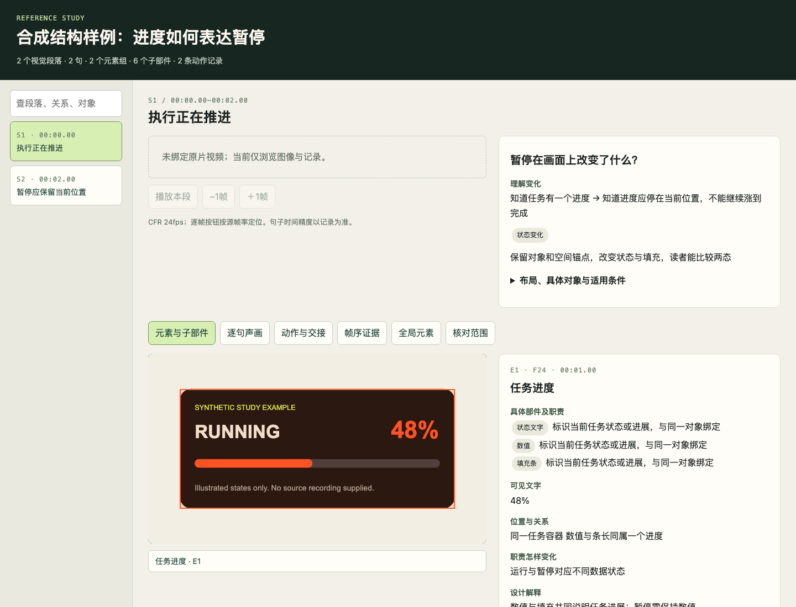

# 参考视频研究工具

把逐句声画、视觉段落、具体元素及子部件、动作状态和转场依据保存在同一份研究记录中，再生成可定位、可检索的本地浏览页。它用于研究任何参考视频；不依赖某条原片或固定段落编号。

研究者负责实际观看、听辨和解释。工具检查记录结构与证据路径，不自动理解视频、转写声音、判断审美或启动视频制作。制作端另见 [dots 制作工具](../dots-production/README.md)。

## 运行合成示例

需要 Python 3.9+，仅使用标准库。以下命令在仓库根运行；示例复制到忽略目录，生成文件不进入 Git。

```bash
mkdir -p .cache
cp -R tools/reference-study/example .cache/reference-study-demo
python3 tools/reference-study/validate.py .cache/reference-study-demo/study.json
python3 tools/reference-study/build_viewer.py .cache/reference-study-demo/study.json
python3 tools/reference-study/serve.py .cache/reference-study-demo
```

最后一条命令输出本机浏览地址；`Ctrl+C` 停止服务。重复体验时换一个新目录，避免把旧资料与示例混在一起。重新生成已有 HTML 必须显式指定 `--force`。

示例只有两张原创 SVG 和人工记录，演示“运行→暂停”的结构。没有原片、实际配音或用户验收，浏览页会明确显示未绑定视频，声音核查保持未完成。校验通过仍会输出这些提醒。



## 建立自己的研究

1. 建独立研究目录，复制 [study.template.json](study.template.json) 为 `study.json`，保留原片或合法的播放副本及证据图。源文件身份、播放副本身份和抽帧方法分别记录。
2. 读取 [分类核查清单](CHECKLIST.md)，先连贯观看并建立全片问题链，再校对原话、划分视觉段落。清单帮助检查遗漏，不要求对不适用的项目编造答案。
3. 用全片索引定位；对状态变化、细节与转场回到原帧率加密检查。记录具体画面元素、内部子部件、位置、职责及变化，分别写可见事实、设计解释、替代解释和适用条件。
4. 填充下表记录。时间统一为源视频秒，帧号从零开始；`bbox` 是画面百分比 `[x,y,width,height]`。普通抽样、逐帧核对、估计时点必须区分。
5. 运行 `validate.py` 修正断链、越界与缺失证据，再用 `build_viewer.py` 和 `serve.py` 浏览原片、元素框、逐句表及帧序证据。回到原片核实，不能用浏览页的数据自证研究结论。
6. 提炼带来源时间码的经验，写清适用条件、反例和未决项。需要落实制作能力时，另做实现及换内容验证；研究结论不会自动变成制作模板。

| 记录 | 内容 |
|---|---|
| `source / status / coverage / audio / limits` | 文件身份、时基、实际观看听辨范围与限制 |
| `scenes` | 连续覆盖原片的视觉段、理解任务、前后认识、布局和导演判断 |
| `sentences` | 原话、译述、句内逻辑、声画分工、时间精度及关联段落/元素 |
| `elements / children / globals` | 具体元素组、子部件及全局对象；形态、位置、作用、依据帧和解释 |
| `events / transitions` | 动作发生点、前态/过程/终态、保留对象及语义交接 |
| `nativeWindows / refinedMotion` | 关键动作的加密窗口、帧序图及细分运动记录 |

字段用法可对照 [合成记录](example/study.json)。`schemaVersion:1`；各主要集合均必填，可为空但不能据此声称该类内容不存在。模板有意保持未完成状态，直接校验会失败。

## 校验与浏览边界

- 检查唯一 ID、引用、视觉时间线连续性、帧/时间一致性、元素归属、包围框和实际证据文件；逐句时间空档单独报告，可能是无口播区，需人工解释。
- 当前逐帧导航支持恒定帧率 CFR。变帧率 VFR 会拒绝；若使用转换后的播放副本，必须另记转换方法与源时间映射，不能沿用不一致的原帧号。
- `normalSpeedAudiovisual` 与 `audio.subjectiveVerified` 只有布尔值 `true` 才表示研究者记录了完成。校验器不能证明记录真实，更不会写入认可。
- `image / strip / localPlayback / evidenceSheets / sheets` 使用研究目录内的相对路径。校验拒绝远程 URL、目录逃逸和越界软链接。浏览服务器只绑定 `127.0.0.1`，提供 GET/HEAD 和视频字节范围读取，不提供写入或目录列表。
- HTML 内嵌记录，图像和视频仍从旁边读取；分享时需保留目录结构，并自行检查内容分享权限。不要把私人原片、转写或路径记录提交进公共仓库。

## 检查工具本身

```bash
python3 -B -m unittest discover -s tools/reference-study -p 'test_*.py' -v
```

测试覆盖结构错误、时间与父子关联、资源边界、HTML 数据转义、覆盖保护及视频范围请求。它们不代替真实研究的画面、声音和论证核查。
